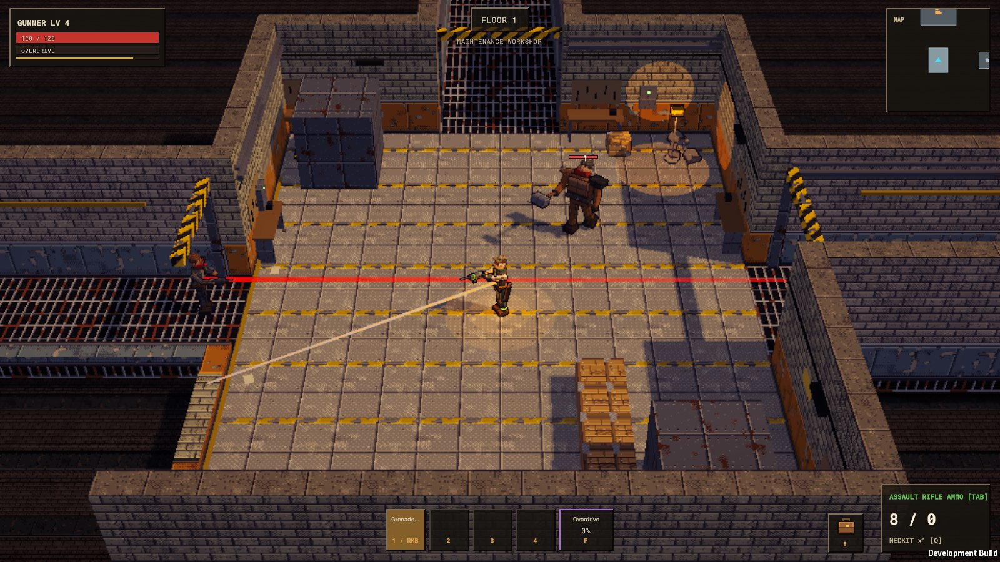
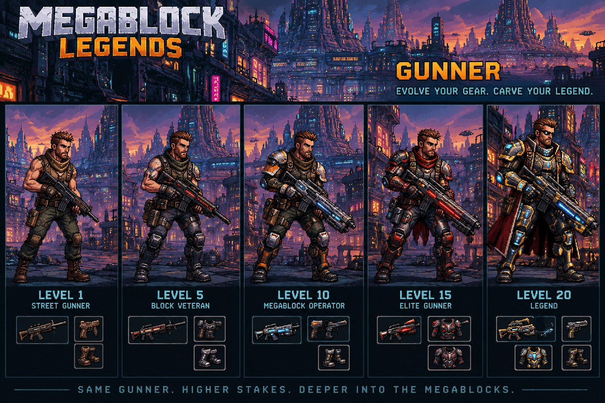
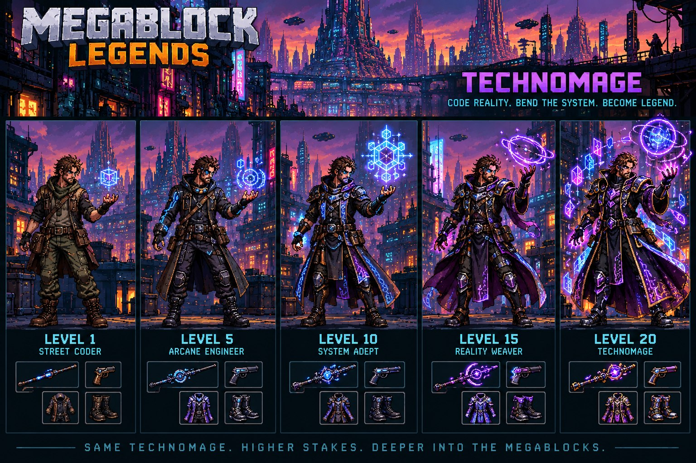
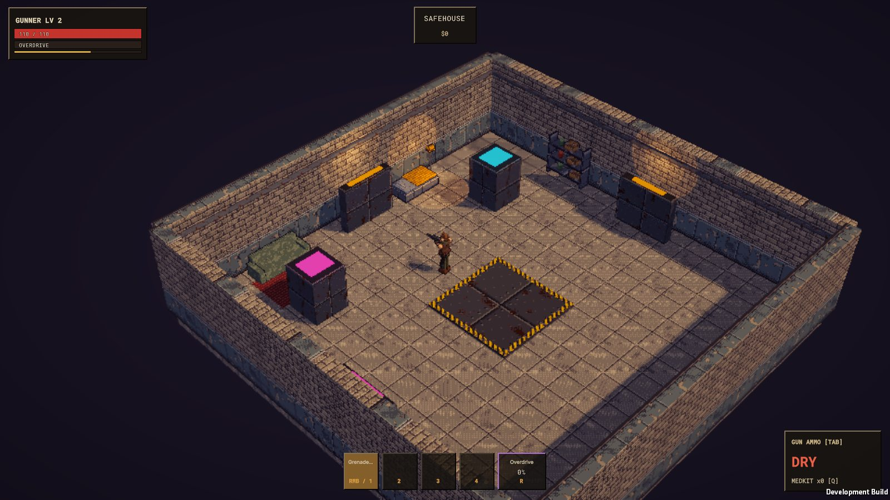
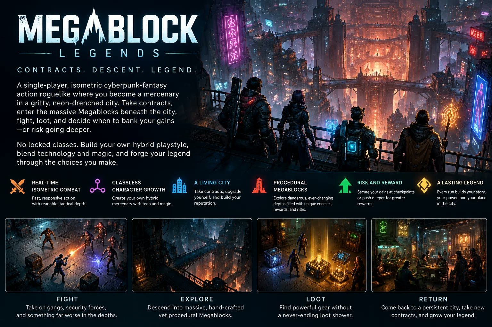

# Megablock Legends

**An original isometric action roguelike, being built in Unity by [bVan!](https://bvansystems.com) and Raven Six Creative.**

In-game capture from the current development build. Not yet released.

| | |
| --- | --- |
| **What is it?** | A single-player action roguelike. You're a mercenary in a gritty city: take contracts, descend into the Megablocks (huge procedural building interiors beneath the city), fight, loot, and decide when to bank your gains or risk going deeper. |
| **Why make it?** | Because I wanted to play it. It mixes the run-based tension of a roguelike with the long-term character growth of a tabletop RPG, in a world where technology and magic are just tools of the trade. |
| **What can it do today?** | The playable prototype has real-time isometric combat, two playable archetypes, procedural floors, loot and equipment, a safehouse between runs, character progression, menus, controller support and produced audio. |
| **Can I see it?** | Screenshots and artwork below. A public build isn't available yet. |
| **Status** | In active development. Private Windows test builds go to invited testers only. |
| **The code?** | The Unity project is private. This repository is a showcase only: images and descriptions, no source and no builds. |

---

## The loop

**Contracts. Descent. Legend.**

1. **Take a contract** from the city.
2. **Descend** into a Megablock: procedural floors full of gangs, security forces and worse.
3. **Fight and loot.** Gear visibly changes your character, from street clothes up to armored kits.
4. **Extract or push deeper.** Bank what you've earned at a checkpoint, or gamble it for better rewards further down.
5. **Return** to the safehouse, gear up, and go again. Your character persists between runs.

There are no locked classes. An archetype is where you *start*, not what you're stuck being.

## Two archetypes, playable now

<table>
<tr>
<td width="50%" valign="top">

### Gunner
An underfunded street-level mercenary with a worn jacket, a carbine and a backup blade. Centre-mass shots expose enemies to follow-up damage, and a core tool (grenade kit, armor plate or combat medkit) shapes how they fight.
</td>
<td width="50%" valign="top">

### Technomage
A resourceful street practitioner with a long coat, wrapped arms and a casting gauntlet. Blade hits overload enemies, and area magic controls the fight. Magic shows up when it's used, not as a constant glow.
</td>
</tr>
</table>

Promotional artwork showing each archetype's progression. The in-game models are simpler, as the screenshots show.

## From the development build

<table>
<tr>
<td width="50%"> Combat on floor 1: a maintenance workshop.</td>
<td width="50%"> The safehouse, between expeditions.</td>
</tr>
</table>

The look is retro-inspired and industrial: chunky low-poly characters, pixel-art-style materials, banded lighting, and lived-in concrete-and-steel interiors. Current in-game art is a work in progress and will change.

## Concept art

Early concept art for the world and the core loop. Concept, not in-game footage.

## Where it's at

- **Built so far:** about two dozen milestones, each designed, approved, built on its own branch and tested before merging. They cover camera and movement, combat and combat states, procedural floors, salvage and mods, equipment and loot, deep runs, controls and inventory, player menus, a standalone Windows build, and produced audio.
- **Now:** **District 1**, the first real slice of the persistent city. An opening apartment connected to the hub is running in development builds, and the district's layout plan is in review.
- **Next:** more of the city, and the rest of the archetypes.
- **Playtesting:** private and invite-only, on Windows. If you'd like to be considered for a future playtest, get in touch through [bvansystems.com](https://bvansystems.com/collaborate).

## Notes

- *Megablock Legends* is the working development title.
- All rights reserved. The images here are shared for viewing only and may not be reused without permission.
- More about the project: [bvansystems.com/creations/megablock-legends](https://bvansystems.com/creations/megablock-legends).

---

Part of the bVan! workshop. See what else is on the bench at <a href="https://github.com/bVan566">github.com/bVan566</a>.
